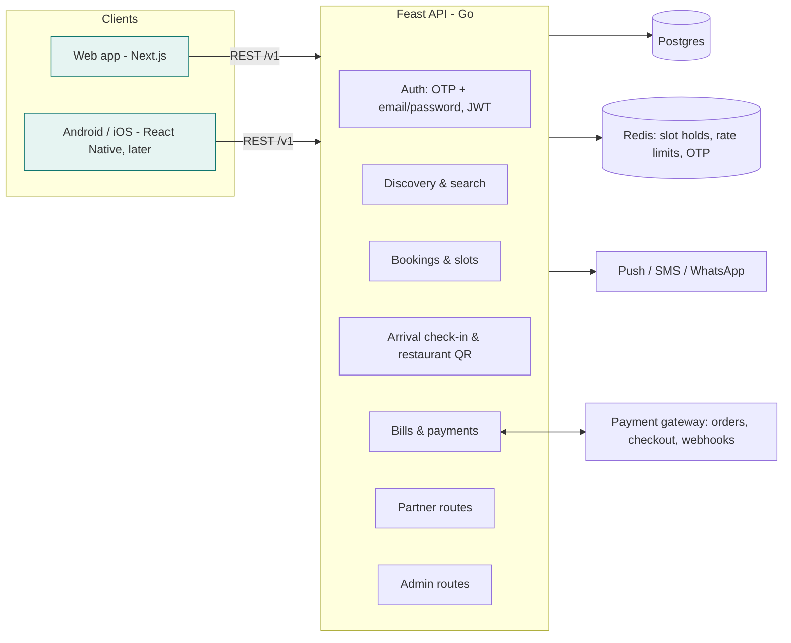

# Feast — architecture

Feast is a dine-out platform for discovering restaurants, pre-booking tables with deals and paying the bill. This repo is the **web app (MVP)**. The backend is mocked in the browser behind a typed API contract, so a Go (or Rust) service can replace it without UI changes. Android and iOS come later and reuse the same contract.

## 1. What we took from the Swiggy Dineout teardown

| Dineout pattern (observed in the APK) | Feast decision |
|---|---|
| Server returns typed widget lists; the app renders them generically | **SDUI-lite**: `GET /v1/home` returns typed `HomeSection`s. Clients skip unknown types. Other screens use typed data, not full SDUI, which is cheaper to build and easier to test. |
| Every API has a protobuf and a `/json` twin; release builds use proto | JSON/REST now, specified in `src/lib/api/types.ts`. Protobuf/Connect is an optional later optimisation for mobile. Money is already integer paise, so the move is lossless. |
| Native discovery, **web** checkout (payments.swiggy.com) inside a WebView, with the URLs controlled by a flag | Web-first, so this is moot today. For mobile: native discovery and booking, and a shared hosted checkout page in a WebView if needed. Keep checkout URLs remotely configurable. |
| Table QR → session → PIN → order → bill fetched from POS with polling + backoff | Not adopted (table ordering and the table PIN were removed in Oct 2026). One printed QR per restaurant (`/r/{code}`) opens its page; a diner with a Feast booking today types in the bill amount and pays with the deal. Old `/t/{code}` table codes open the same page. |
| Pre-book deals vary by slot (off-peak bigger) | `getSlots` attaches a deal to each slot: base pre-book % +10 off-peak, −10 at peak. A same-day booking's deal carries over to bill payment. |
| Internal deep-link scheme (`swiggydiners://…`) with web URLs rewritten to it | Every CTA is an app route (`/restaurants/{slug}`, `/r/{code}`, `/pay/{slug}`). Mobile maps the same paths to native screens (universal links / app links). |
| Dedicated backend host for Dineout (`dinersone-proxy`) | One API with clear route groups (`/v1`, `/v1/partner`, `/v1/admin`). Split into services only when scale demands it. |

## 2. Roles

| Capability | Customer | Owner (partner) | Admin |
|---|---|---|---|
| Browse, search, view restaurants | ✓ | ✓ | ✓ |
| Book tables, check in ("I'm here"), pay bills | ✓ | ✓ | ✓ |
| Partner portal for **their** restaurants: dashboard, bookings (arrivals, seat / no-show), the restaurant QR code, menu availability and price, offers, settings, pause/resume, payments | — | ✓ | ✓ (any restaurant) |
| Approve, suspend or edit restaurants, onboard new ones | — | — | ✓ |
| Manage users and roles, link owners to restaurants, block accounts | — | — | ✓ |
| All bookings and payments, platform metrics, reset demo data | — | — | ✓ |

Rules enforced by the backend (the mock implements the same checks; UI guards are only for UX):

- Owners act only on `restaurantIds` they're linked to. Admins pass every owner check.
- Owners may only toggle `LIVE ⇄ PAUSED`. Approval and suspension are admin-only.
- Bank offers are platform-funded, so owners can't change them.
- Admins can't remove their own admin role or block themselves.
- Prices are always re-computed server-side from the menu. Client prices are ignored.
- Customers see `LIVE` and `PAUSED` restaurants. `PAUSED` hides booking, paying and ordering. `PENDING_APPROVAL` and `SUSPENDED` are hidden (404).

Demo accounts: diner `9876543210` with OTP `123456` · owner `owner@feast.demo` · Mumbai owner `owner.mumbai@feast.demo` · admin `admin@feast.demo` (password `feast123`).

## 3. System view



## 4. Web app structure

```
src/
  app/                      Next.js App Router pages (one folder per route)
    page.tsx                Discover (server-driven sections)
    search/                 Search + filters
    restaurants/[slug]/     Restaurant page, /book flow
    bookings/               My bookings & payments, booking detail
    dine-in/                At the restaurant: today's booking, "I'm here", pay bill
    r/[code]/, t/[code]/    Restaurant QR landing (t/ = old table codes) → restaurant page
    pay/[slug]/, payments/  Pay bill (amount typed from the restaurant's bill), receipt
    login/                  OTP (diners) + email (partners/admins)
    partner/                Owner portal (guarded: OWNER, ADMIN)
    admin/                  Admin console (guarded: ADMIN)
  components/               UI kit, app shell, portal shell, guards, checkout sheet
  lib/
    api/types.ts            ← THE CONTRACT (framework-free; moves to packages/core for mobile)
    api/client.ts           FeastApi interface + per-method REST route + role
    api/http.ts             Real HTTP client (Bearer token)
    api/mock/               In-browser mock backend: seed data, rules, localStorage DB
    pricing.ts              Pure pricing rules: discounts, GST, round-off, cover charge
    hooks.ts, format.ts     Data hooks, formatting
```

Switch backends with env vars: `NEXT_PUBLIC_API_MODE=http` and `NEXT_PUBLIC_API_BASE_URL=https://api…`.

**Responsive by design.** On phones: bottom tab bar, sticky action bars, bottom sheets, swipe carousels, and card lists in the portals. On desktop: top nav with inline search, multi-column grids, a sticky side action panel, centered dialogs, and a sidebar with data tables in the portals.

## 5. API contract (implement in Go)

All money is integer **paise**. Errors return `{ code, message }` with a meaningful HTTP status. Auth header: `Authorization: Bearer <token>`.

| Method & path | Access | Purpose |
|---|---|---|
| POST /v1/auth/otp · POST /v1/auth/otp/verify | public | Diner OTP sign-in (auto-creates CUSTOMER) |
| POST /v1/auth/login · POST /v1/auth/logout · GET /v1/me | public / user | Partner & admin login, session |
| GET /v1/cities · GET /v1/home?city= | public | Cities, server-driven home sections |
| GET /v1/restaurants?city=&q=&cuisine=&tag=&pureVeg=&minRating=&sort= | public | Search with facets |
| GET /v1/restaurants/{slug} · GET /v1/restaurants/{id}/menu | public | Detail, menu |
| GET /v1/restaurants/{id}/slots?date=&guests= | public | Slots with per-slot deals |
| POST /v1/bookings (idempotencyKey) · GET /v1/bookings/{id} · GET /v1/me/bookings · POST /v1/bookings/{id}/cancel | customer | Bookings |
| GET /v1/qr/{code} | public | Restaurant QR lookup (also accepts old table codes) |
| POST /v1/bookings/{id}/check-in | customer | "I'm here" arrival notice |
| POST /v1/bills/quote {restaurantId, billAmount, tip, offerId?, bookingId?} | customer | Server-side pricing with best offer; needs a Feast booking today (`BOOKING_REQUIRED`) |
| POST /v1/payments/intents · POST /v1/payments/intents/{id}/confirm | customer | Payment intent → gateway → result |
| GET /v1/bill-payments/{id} · GET /v1/me/bill-payments | customer | Receipts |
| GET /v1/partner/restaurants · …/{id}/dashboard · …/{id}/bookings?date= · POST /v1/partner/bookings/{id}/status | owner | Partner ops |
| GET …/{id}/qr · GET …/{id}/payments | owner | Restaurant QR code, settlements |
| GET …/{id}/menu · PATCH …/{id}/menu/items/{itemId} · PUT …/{id}/offers · PATCH …/{id}/settings | owner | Menu, offers, settings |
| POST /v1/admin/restaurants/{id}/status | owner (pause/resume) / admin | Lifecycle |
| GET /v1/admin/metrics · GET/POST /v1/admin/restaurants · PATCH /v1/admin/restaurants/{id} | admin | Platform ops |
| GET/POST /v1/admin/users · PATCH /v1/admin/users/{id} · GET /v1/admin/bookings · GET /v1/admin/payments | admin | Users/roles, audit |

`src/lib/api/client.ts` is the source of truth for signatures. Generating an OpenAPI spec from it is the first backend task (§7).

## 6. Data model (Postgres sketch)

```
users(id, name, phone UNIQUE NULL, email UNIQUE NULL, role, status, created_at)
restaurant_owners(user_id, restaurant_id)                 -- many-to-many
restaurants(id, slug UNIQUE, name, city_id, area, cuisines[], tags[], cost_for_two, price_band,
            is_pure_veg, status, settings jsonb, about, address, phone, rating, rating_count, hue, motif)
menu_categories(id, restaurant_id, name, position)
menu_items(id, category_id, name, description, price, is_veg, available, spice_level, bestseller,
           variants jsonb, addons jsonb)
offers(id, restaurant_id NULL, scope, percent_off, flat_off, max_discount, min_bill, terms[], active)
bookings(id, code, user_id, restaurant_id, date, time, guests, deal jsonb, status, cover_charge,
         idempotency_key UNIQUE(user_id, key), created_at)
bills(id, restaurant_id, booking_id NULL, bill_amount, lines jsonb, applied_offer jsonb, savings, payable)
payment_intents(id, purpose, reference_id, amount, status, gateway_order_id, failure_reason)
bill_payments(id, user_id, bill_id, intent_id, method, amount, paid_at)
audit_log(id, actor_id, action, entity, entity_id, before jsonb, after jsonb, at)  -- every admin/owner write
```

Slot capacity: `count(bookings where slot) < settings.tablesPerSlot`. Enforce it in a transaction, or hold the slot in Redis for 5 minutes while payment is pending.

## 7. Moving to the Go backend

1. **Contract first.** Turn `client.ts`/`types.ts` into `openapi.yaml`. Generate Go server stubs (`oapi-codegen`) and TS types from it, so the contract can't drift.
2. **Stack.** Go + chi (or echo), Postgres + sqlc, golang-migrate, Redis. JWT access tokens + refresh tokens in httpOnly cookies on web; OTP through an SMS provider.
3. **Port the rules**, not the UI: `pricing.ts` and the checks in `mock/index.ts` (authorization, transitions, validation) become Go domain packages with unit tests.
4. **Payments.** Replace `confirmPayment` with: create a gateway order → client opens checkout → **webhook** marks the intent `SUCCEEDED` → booking/bill updated. Never trust the client's success callback alone.
5. **Realtime.** Replace polling on the bookings board and payments queue with SSE or WebSockets. Keep polling as a fallback.
6. **Flip the switch.** Set `NEXT_PUBLIC_API_MODE=http`. Run the e2e suite against both modes.

## 8. Mobile plan (Android and iOS)

- **React Native (Expo)** in a monorepo: `apps/web` (this), `apps/mobile`, `packages/core` (types, API client, pricing, formatting).
- Same API and auth. Deep links `https://feast.app/r/{code}` open the restaurant natively, so camera scans of the restaurant QR code land in the app.
- Native extras: camera QR scanner, push notifications (booking reminders, diner arrived), wallet passes for bookings, biometric sign-in.
- Optional later: protobuf/Connect for smaller payloads, and server-driven sections on more screens.

## 9. Not in the MVP yet

Real auth and payments · reviews and ratings submission · photos/CDN · maps and geolocation sorting · notifications · POS integrations · settlements and payouts · refunds · multi-language · dark mode · analytics/experiments · rate limiting and abuse protection on OTP attempts.
